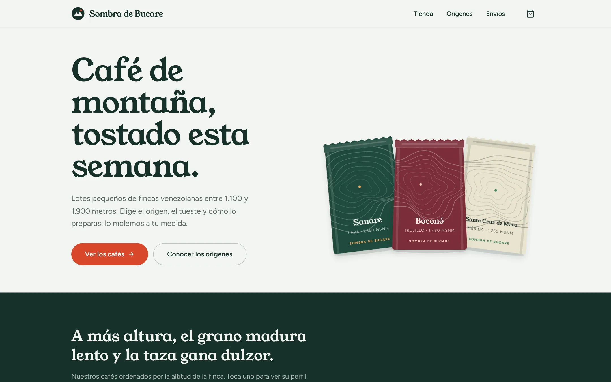
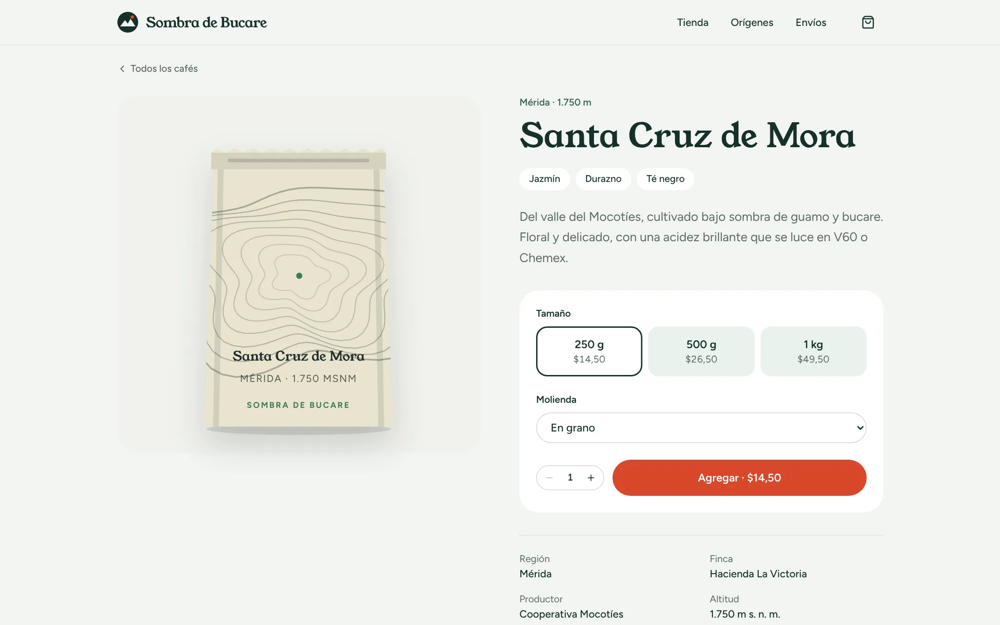
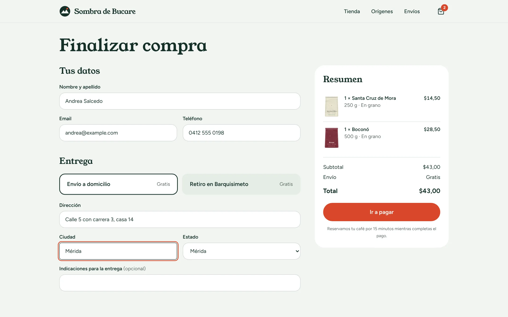
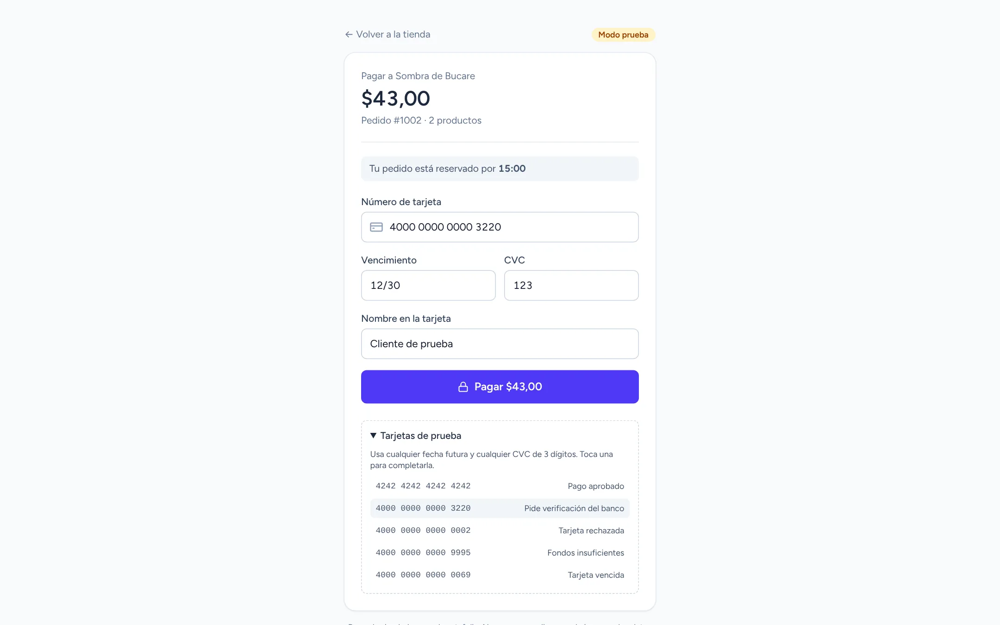
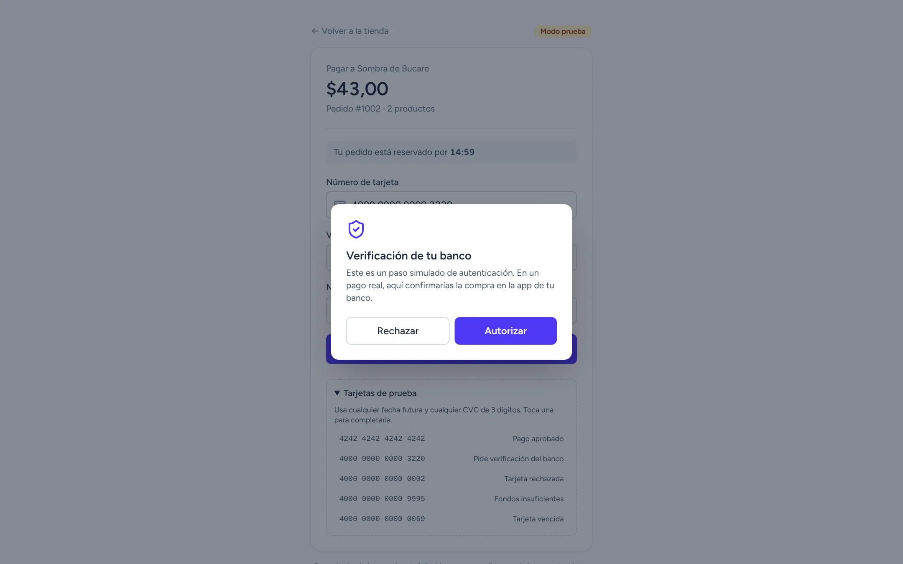
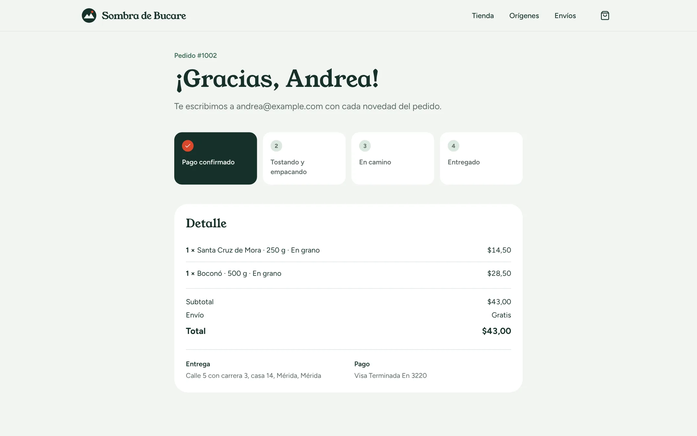
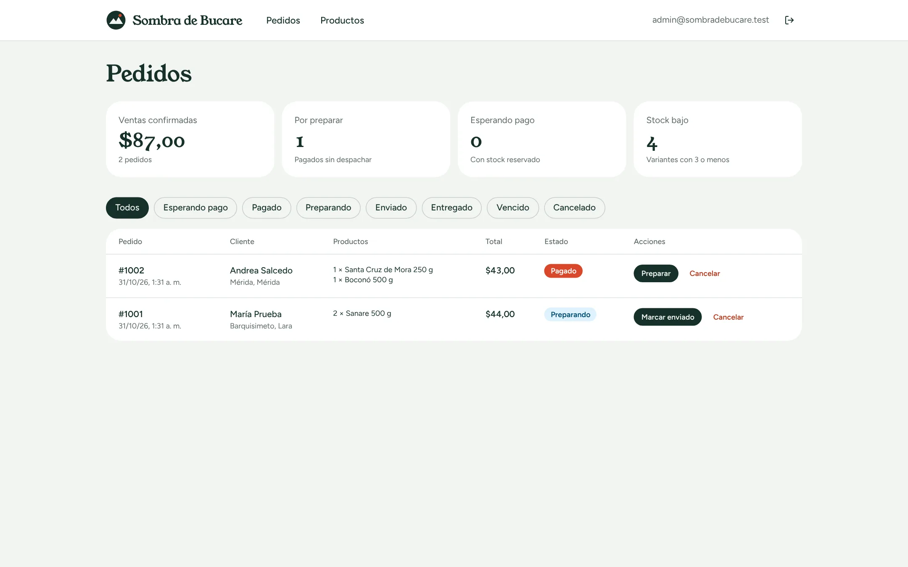

# Sombra de Bucare · tienda de café

**[Español](#español) · [English](#english)**

> 🔗 **Demo:** [sombradebucare.vercel.app](https://sombradebucare.vercel.app) · Panel: `/admin` con el botón de cuenta de demostración · Pagos simulados, sin dinero real / Simulated payments, no real money.



<table>
  <tr>
    <td width="50%"><br><sub><b>Producto</b> · tamaño, molienda y stock en vivo / size, grind and live stock</sub></td>
    <td width="50%"><br><sub><b>Checkout</b> · validado en el servidor / server-side validation</sub></td>
  </tr>
  <tr>
    <td><br><sub><b>Pasarela de prueba</b> · tarjetas con distintos resultados / test cards with different outcomes</sub></td>
    <td><br><sub><b>Verificación del banco</b> · flujo tipo 3-D Secure / 3-D Secure-style step</sub></td>
  </tr>
  <tr>
    <td><br><sub><b>Pedido</b> · estado en tiempo real para el cliente / live status for the customer</sub></td>
    <td><br><sub><b>Panel</b> · ventas, pedidos y cambios de estado / sales, orders and status changes</sub></td>
  </tr>
</table>

---

## Español

Tienda online completa de café de especialidad venezolano: catálogo con filtros, carrito, checkout, una pasarela de pago de prueba y un panel de administración. Las fincas y productores son ficticios; las regiones cafetaleras son reales.

### Qué muestra este proyecto

- **Inventario sin sobreventa.** Al crear el pedido, el stock se reserva dentro de una transacción con un `UPDATE … WHERE stock >= cantidad`, así dos compras simultáneas no pueden llevarse la última unidad. Si el pago no llega en 15 minutos, la reserva vence y el stock vuelve al inventario.
- **Precios que no se pueden manipular.** El navegador solo envía qué productos quiere y cuántos. Precios, envío y total se recalculan en el servidor.
- **Pagos con arquitectura real.** La pasarela simulada implementa una interfaz `PaymentProvider` y confirma los pagos con un **webhook firmado con HMAC** (mismo esquema que Stripe), con verificación de antigüedad e **idempotencia**: un evento repetido no se procesa dos veces. Cambiar a Stripe o Mercado Pago es implementar esa interfaz.
- **Tarjetas de prueba:** aprobada, rechazada, fondos insuficientes, vencida y una que pide **verificación del banco**. El número se valida con el algoritmo de Luhn.
- **Panel de administración** protegido con sesión JWT en cookie `httpOnly`. Cada server action verifica la sesión por su cuenta, porque son endpoints públicos. Incluye estados de pedido con transiciones válidas (cancelar devuelve el stock) y edición de stock y precios.
- **SEO:** metadatos por página, `sitemap.xml`, `robots.txt` y datos estructurados `Product` con precio y disponibilidad.
- **Ilustraciones generativas:** cada bolsa de café es un SVG con curvas de nivel únicas, calculadas a partir de la región y la altitud de la finca.

### Stack

- **Next.js 16** (App Router, Server Actions, `proxy`) · **React 19** · **TypeScript** · **Tailwind CSS 4**
- **Neon** (Postgres serverless) + **Drizzle ORM**, con migraciones versionadas en [`drizzle/`](drizzle)
- **Zod** para validación · **Zustand** para el carrito · **jose** para la sesión
- **PGlite** (Postgres en WebAssembly) para tests y desarrollo local: no hace falta instalar Postgres

### Tests

- **Lógica de negocio (Vitest + PGlite):** 16 tests contra un Postgres real en memoria con las mismas migraciones que producción. Cubren reserva y vencimiento de stock, compras simultáneas, cálculo de envío, cada tarjeta de prueba, firma e idempotencia del webhook y transiciones del panel.
- **De punta a punta (Playwright):** 19 pasos reales: filtrar, agregar al carrito, validar el checkout, pagar con tarjetas que fallan y luego con verificación del banco, ver el pedido, entrar al panel, cambiar el estado y comprobar que el cliente lo ve.

```bash
pnpm test                       # lógica de negocio
BASE_URL=http://localhost:3000 pnpm e2e   # con la app levantada
```

### Correr en local

```bash
pnpm install
cp .env.example .env.local      # completa AUTH_SECRET y ADMIN_PASSWORD
pnpm db:setup                   # crea la base local (PGlite) y carga el catálogo
pnpm dev
```

Para producción, define `DATABASE_URL` de Neon y corre `pnpm db:migrate`. Un cron diario (`vercel.json`) restablece el catálogo de la demo.

### Estructura

| Carpeta | Contenido |
|---|---|
| [`src/server/`](src/server) | Lógica de negocio sin dependencias de React: catálogo, checkout, pagos, panel |
| [`src/server/payments/`](src/server/payments) | Interfaz de pasarela, pasarela simulada, webhook firmado |
| [`src/db/`](src/db) | Esquema Drizzle, conexión (Neon o PGlite) y datos de ejemplo |
| [`src/app/`](src/app) | Rutas: tienda, checkout, pasarela, pedido, panel y API |

---

## English

A full online store for Venezuelan specialty coffee: filtered catalog, cart, checkout, a test payment gateway and an admin dashboard. Farms and producers are fictional; the coffee regions are real.

### Highlights

- **No overselling.** Stock is reserved inside a transaction with a conditional `UPDATE … WHERE stock >= qty`, so two simultaneous checkouts can't both take the last unit. Unpaid reservations expire after 15 minutes and return to inventory.
- **Tamper-proof pricing.** The browser only sends product ids and quantities; prices, shipping and totals are recomputed on the server.
- **Real payment architecture.** The simulated gateway implements a `PaymentProvider` interface and confirms payments through an **HMAC-signed webhook** (Stripe's scheme) with timestamp tolerance and **idempotency**. Swapping in Stripe or Mercado Pago means implementing that interface.
- **Test cards:** approved, declined, insufficient funds, expired, and one that triggers a **bank verification** step. Card numbers are Luhn-checked.
- **Admin dashboard** behind a JWT session in an `httpOnly` cookie. Every server action re-checks the session, since server actions are public endpoints. It handles order status transitions (cancelling restocks) and stock and price editing.
- **SEO:** per-page metadata, `sitemap.xml`, `robots.txt` and `Product` structured data.
- **Generative artwork:** every coffee bag is an SVG with unique contour lines derived from the farm's region and altitude.

### Stack

Next.js 16 · React 19 · TypeScript · Tailwind CSS 4 · Neon + Drizzle ORM · Zod · Zustand · jose · PGlite for tests and local development.

### Tests

- **Business logic (Vitest + PGlite):** 16 tests against a real in-memory Postgres running the production migrations.
- **End to end (Playwright):** 19 real steps from browsing to paying (including failed cards and bank verification) to updating the order in the dashboard.

### Run locally

```bash
pnpm install
cp .env.example .env.local
pnpm db:setup   # local PGlite database + sample catalog
pnpm dev
```

---

Hecho por / Built by **Jose Torres** · [GitHub](https://github.com/xTorres97)
